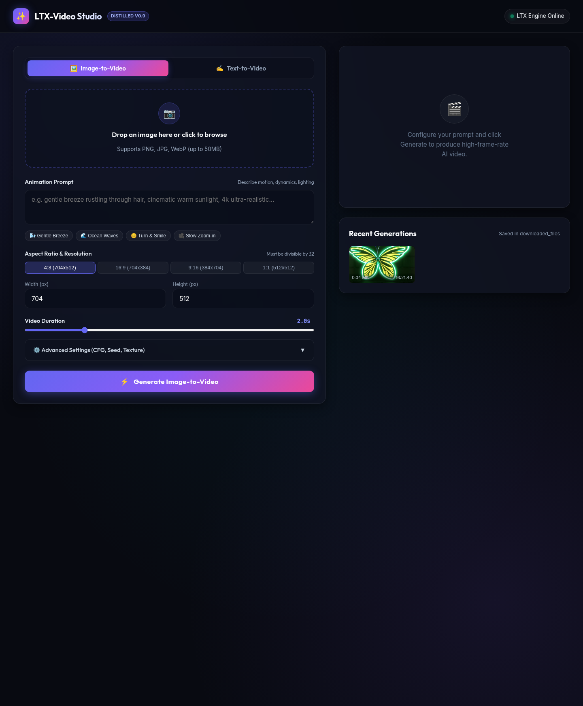

# LTX-Video Generation Shortcut & Automation

A high-performance automated pipeline for generating AI videos using **Lightricks LTX-Video Distilled**, reverse-engineered from Gradio 5 REST/SSE APIs and Perchance.

Provides two execution paths:
1. **Direct HTTP Request/Response Engine** ([`src/ltx_video.py`](src/ltx_video.py)): Lightweight, pure Python requests with real-time SSE progress streaming. Generates and downloads videos in **~6.5 seconds** with zero browser overhead.
2. **SeleniumBase Browser Engine** ([`src/gen_selenium.py`](src/gen_selenium.py)): Visual automation for [`https://perchance.org/ltx-video`](https://perchance.org/ltx-video) using Undetected Chromedriver (UC mode) to bypass Cloudflare Turnstile, modeled after [`headless-telebot`](/home/sahan-weerasiri/projects/headless_telebot).

---

## 📁 Repository Structure

```text
.
├── src/
│   ├── ltx_video.py          # Primary direct HTTP & SSE API client + CLI tool
│   └── gen_selenium.py       # SeleniumBase UC-mode browser fallback generator
├── docs/
│   ├── findings/
│   │   ├── data.txt          # Browser DevTools network trace of Gradio queue calls
│   │   └── data2.txt         # Perchance generator & Firebase telemetry script
│   └── adr/                  # Architecture Decision Records (ADRs)
│       ├── README.md         # ADR index and guidelines
│       ├── 0001-direct-http-sse-over-browser-automation.md
│       ├── 0002-client-side-session-hash-generation.md
│       ├── 0003-cloudflare-challenge-bypass-via-direct-space-api.md
│       ├── 0004-dual-engine-architecture-api-and-selenium-fallback.md
│       └── 0005-gui-service-architecture-and-configuration.md
├── downloaded_files/         # Destination directory for generated MP4 videos
├── .env.example              # GUI, networking, port, and engine configuration template
├── requirements.txt          # Python dependencies (requests, Pillow, seleniumbase)
├── AGENTS.md                 # Engineering guidelines and development standards
└── README.md                 # Project documentation and onboarding
```

---

## 🚀 Quick Start (venv Setup)

Follow these steps to set up the isolated Python virtual environment, install dependencies, and start generating:

### 1. Create & Activate the Virtual Environment

```bash
# Create virtual environment in .venv
python3 -m venv .venv

# Activate on Linux / macOS:
source .venv/bin/activate

# (On Windows PowerShell: .venv\Scripts\Activate.ps1)
# (On Windows Command Prompt: .venv\Scripts\activate.bat)
```

### 2. Install Required Dependencies

```bash
pip install --upgrade pip
pip install -r requirements.txt
```

### 3. Initialize Environment Configuration

```bash
cp .env.example .env
```
*(Optionally adjust `GUI_PORT`, `OUTPUT_DIR`, or backend settings in `.env`)*

### 4. Launch

#### Option A: Start the Web Studio GUI
```bash
python src/server.py
```
Open **[http://localhost:7860](http://localhost:7860)** in your browser.

#### Option B: Run via Direct CLI
```bash
# Image-to-Video
python src/ltx_video.py --image path/to/image.png --prompt "gentle breeze moving hair"

# Text-to-Video
python src/ltx_video.py --prompt "an astronaut walking on mars at sunset"
```

---

## 🔍 Key Technical Findings

### 1. How `perchance.org/ltx-video` Works
When inspecting `https://perchance.org/ltx-video` via SeleniumBase DOM traversal, the generator is an iframe embed wrapper:
```html
<iframe id="outputIframeEl" src="...">
  <iframe id="genFrame" src="https://lightricks-ltx-video-distilled.hf.space"></iframe>
</iframe>
```
The actual video generation engine is hosted on Hugging Face Spaces:
`https://lightricks-ltx-video-distilled.hf.space`

### 2. How the `session_hash` is Generated
In Gradio 5 applications, the `session_hash` is **not a cryptographic signature or anti-bot challenge token**. It is a client-generated pseudo-random identifier:
- **Gradio JavaScript Client:**
  ```javascript
  const session_hash = Math.random().toString(36).substring(2, 13);
  ```
- **Python Equivalent:**
  ```python
  import random, string
  session_hash = ''.join(random.choices(string.ascii_lowercase + string.digits, k=11))
  ```
Any random 11-character alphanumeric string is valid and accepted by the Gradio queue API.

### 3. Why Cloudflare Does NOT Affect the CLI (Reliability Guarantee)
- **Origin of Cloudflare Protection**: The Cloudflare Turnstile challenge (*"Just a moment..."*) is configured exclusively on `perchance.org` to protect its web interface from automated scraping.
- **Direct API Bypass**: The CLI ([`src/ltx_video.py`](src/ltx_video.py)) completely bypasses `perchance.org` and connects directly to the Hugging Face Space backend (`https://lightricks-ltx-video-distilled.hf.space`).
- **Open API Endpoints**: Hugging Face Spaces expose their standard Gradio REST and SSE endpoints (`/gradio_api/upload`, `/gradio_api/queue/join`, `/gradio_api/queue/data`) directly via Uvicorn/FastAPI without CAPTCHAs, Turnstile, or anti-bot verification.
- **Space Wake-up & Error Handling**:
  - `ltx_video.py` automatically checks if the Hugging Face space is asleep and waits for it to wake up (`check_and_wake_space()`) before submitting tasks.
  - Video dimensions are automatically normalized to multiples of 32 to prevent model validation errors.
  - If browser-based automation is ever required, [`src/gen_selenium.py`](src/gen_selenium.py) provides a guaranteed fallback using SeleniumBase UC Mode.

---

## ⚡ 1. Direct Request/Response Automation (`src/ltx_video.py`)

No browser, chromedriver, or display server required.

### Features
- **Image-to-Video** (`fn_index: 5`) and **Text-to-Video** (`fn_index: 4`)
- Automatic aspect-ratio & dimension calculation (`fn_index: 0`)
- Real-time Server-Sent Events (SSE) queue position and generation progress
- Streaming video download to disk

### CLI Usage

```bash
# Image-to-Video
python3 src/ltx_video.py --image path/to/image.png --prompt "gentle breeze moving hair, cinematic" --output downloaded_files/result.mp4

# Custom duration & dimensions
python3 src/ltx_video.py -i input.png -p "water waves rippling" -d 4.0 -W 704 -H 512 -o downloaded_files/waves.mp4

# Fast mode (skips two-pass texture enhancement)
python3 src/ltx_video.py -i input.png -p "smiling softly" --no-improve-texture -o downloaded_files/fast.mp4

# Text-to-Video (without image)
python3 src/ltx_video.py --prompt "an astronaut walking on mars at sunset" --output downloaded_files/mars.mp4
```

### Python Library Usage

```python
from src.ltx_video import LTXVideoClient

client = LTXVideoClient()

# Generate video from image
output_file = client.generate_image_to_video(
    image_path="photo.png",
    prompt="the person turns and smiles softly",
    duration=2.0,
    output_path="downloaded_files/output.mp4"
)
print(f"Video saved to: {output_file}")
```

---

## 🌐 2. SeleniumBase Browser Automation (`src/gen_selenium.py`)

Modeled after [`headless-telebot/gen.py`](/home/sahan-weerasiri/projects/headless_telebot/gen.py):
- Uses SeleniumBase **UC Mode** to bypass Cloudflare Turnstile on `perchance.org`.
- Traverses nested iframes (`#outputIframeEl` -> `#genFrame`).
- Automates the UI: uploads to `input[type="file"]`, sets the prompt, triggers `Generate Image-to-Video`, polls for the `<video>` element, and downloads the MP4.

### CLI Usage

```bash
# Run headless (default)
python3 src/gen_selenium.py --image input.png --prompt "camera zooming in slowly" --output downloaded_files/result.mp4

# Run with visible browser window
python3 src/gen_selenium.py --image input.png --prompt "camera zooming in slowly" --headed
```

---

## 🖥️ 3. Web GUI Studio (`src/server.py`)

A modern, responsive web application for interactive video generation:



### Features
- **Visual Drag & Drop Upload**: Upload any PNG, JPG, or WebP image with automatic aspect ratio detection.
- **Aspect Ratio Presets**: One-click selection for 16:9, 9:16, 1:1, and 4:3 resolutions (guaranteed divisible by 32).
- **Inspiration Prompts**: Quick prompt chips for fast animation ideas.
- **Real-Time SSE Progress Bar**: Live progress tracking displaying queue position, ETA, and step-by-step diffusion rendering.
- **Embedded Player**: Instant playback, loop, fullscreen, MP4 download, and link sharing.
- **Recent Generations Gallery**: Local gallery displaying previously generated videos with timestamps, file sizes, and one-click deletion.
- **Live Space Health Indicator**: Automatic polling indicating backend engine health (Online, Waking Up, Offline).

### Starting the Web GUI

```bash
# Start server on default port 7860
python3 src/server.py

# Or customize host & port
GUI_PORT=8080 GUI_HOST=0.0.0.0 python3 src/server.py
```
Open **[http://localhost:7860](http://localhost:7860)** in your browser.

---

## ⚙️ Environment Configuration (`.env`)

For running the GUI interface and configuring network ports, copy the template:
```bash
cp .env.example .env
```

Key environment variables:
| Variable | Default | Description |
|---|---|---|
| `GUI_HOST` | `0.0.0.0` | Network interface for GUI server binding |
| `GUI_PORT` | `7860` | Web port for the GUI interface (e.g. 7860 or 8080) |
| `LTX_BACKEND_URL` | `https://lightricks-ltx-video-distilled.hf.space` | Hugging Face Space endpoint |
| `HF_TOKEN` | *(optional)* | Hugging Face user token for elevated rate limits |
| `OUTPUT_DIR` | `./downloaded_files` | Directory where generated MP4 videos are saved |
| `DEFAULT_DURATION`| `2.0` | Target video duration in seconds (0.3s - 8.5s) |
| `DEFAULT_WIDTH` | `704` | Default width (must be divisible by 32) |
| `DEFAULT_HEIGHT`| `512` | Default height (must be divisible by 32) |

---

## 📐 Architecture Decision Records (ADRs)

Key architectural choices are documented in [`docs/adr/`](docs/adr/):

- [**ADR-0001**](docs/adr/0001-direct-http-sse-over-browser-automation.md): Direct HTTP and SSE API Automation Over Browser Scraping
- [**ADR-0002**](docs/adr/0002-client-side-session-hash-generation.md): Client-Side Session Hash Generation Scheme
- [**ADR-0003**](docs/adr/0003-cloudflare-challenge-bypass-via-direct-space-api.md): Cloudflare Challenge Bypass via Direct Space API Architecture
- [**ADR-0004**](docs/adr/0004-dual-engine-architecture-api-and-selenium-fallback.md): Dual-Engine Architecture (Direct API Primary with SeleniumBase UC Fallback)
- [**ADR-0005**](docs/adr/0005-gui-service-architecture-and-configuration.md): GUI Service Architecture and Environment Configuration

---

## 📦 Manual Setup & Installation

```bash
# 1. Create a virtual environment
python3 -m venv .venv

# 2. Activate the virtual environment
source .venv/bin/activate       # Linux / macOS
# .venv\Scripts\Activate.ps1    # Windows PowerShell
# .venv\Scripts\activate.bat    # Windows Command Prompt

# 3. Upgrade pip and install requirements
pip install --upgrade pip
pip install -r requirements.txt

# 4. Copy environment configuration
cp .env.example .env
```
